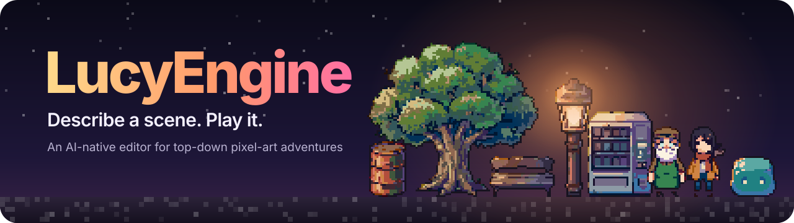
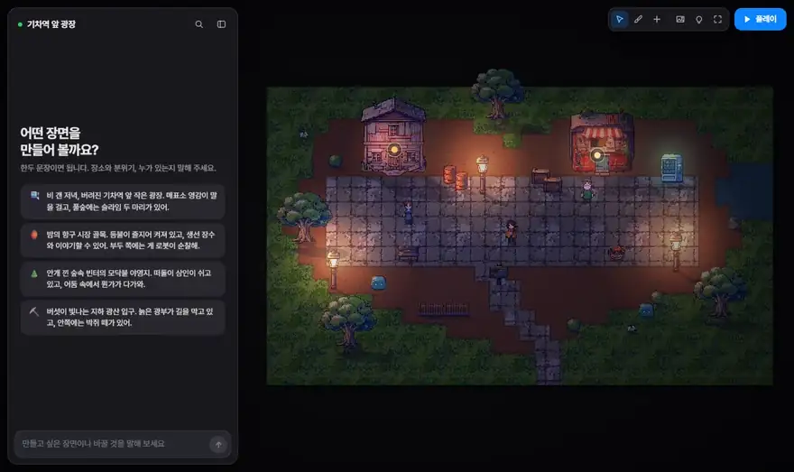
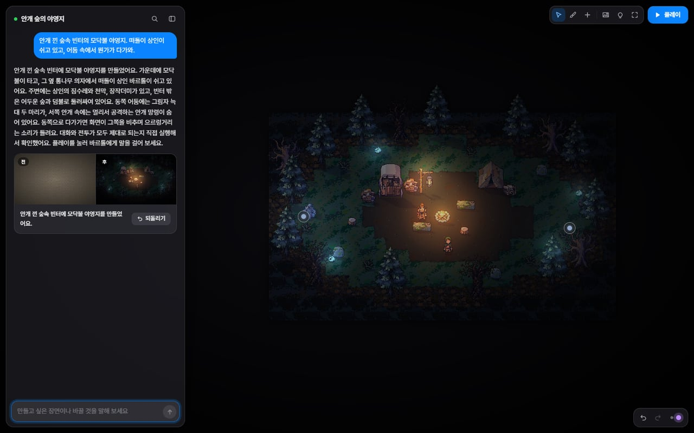
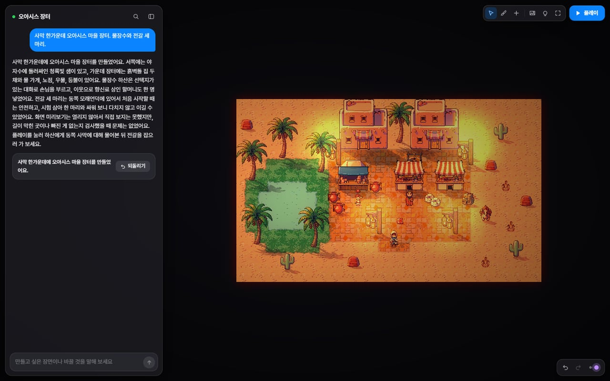
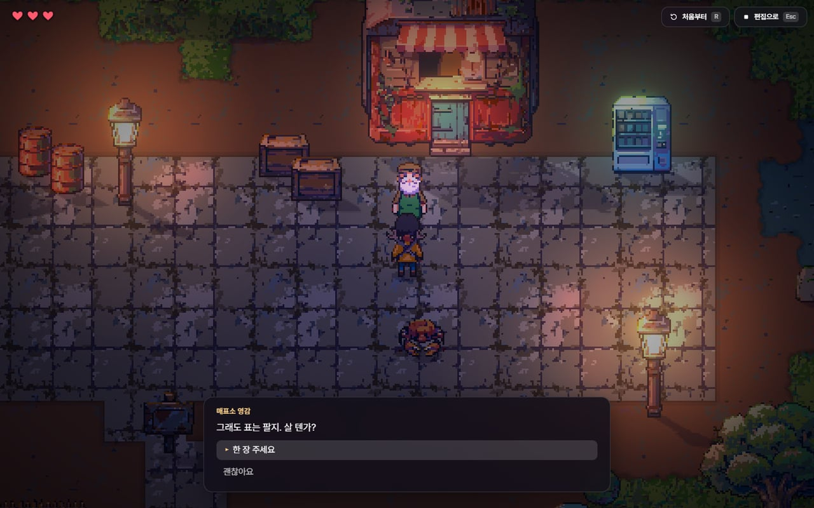
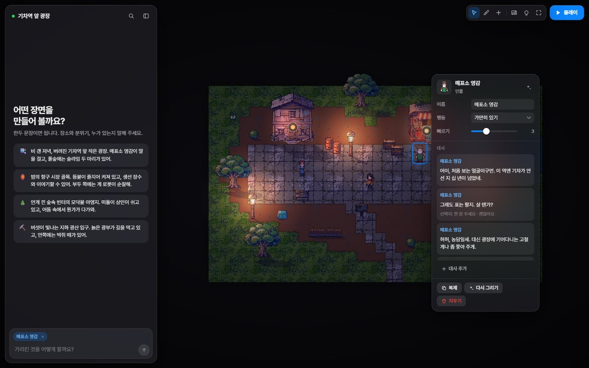
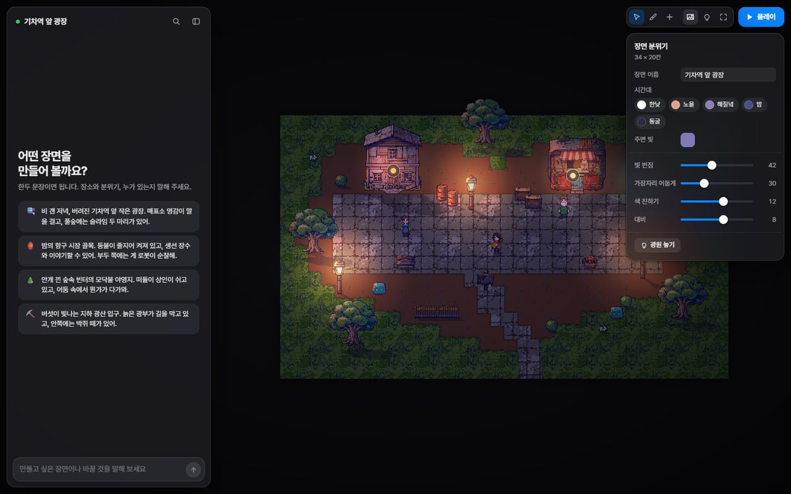
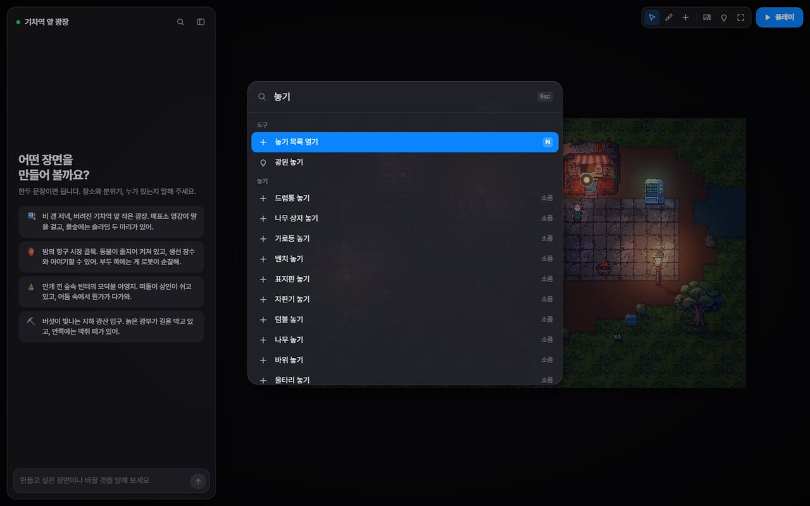
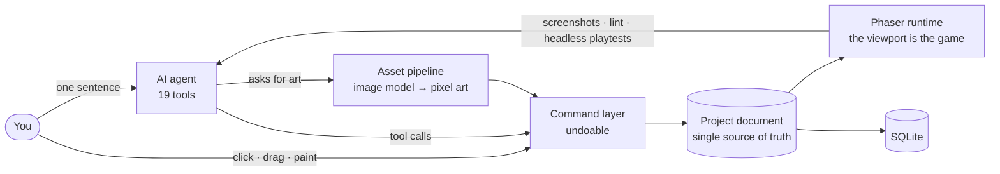

<p align="center">
  
</p>

<p align="center">
  <a href="LICENSE"></a>
  
  
  
  
  
</p>

<p align="center">
  <b><a href="#english">English</a></b> &nbsp;·&nbsp;
  <b><a href="#简体中文">简体中文</a></b> &nbsp;·&nbsp;
  <b><a href="#日本語">日本語</a></b> &nbsp;·&nbsp;
  <b><a href="#한국어">한국어</a></b>
</p>

<p align="center">
  
</p>

<table>
  <tr>
    <td width="50%"></td>
    <td width="50%"></td>
  </tr>
  <tr>
    <td></td>
    <td></td>
  </tr>
  <tr>
    <td></td>
    <td></td>
  </tr>
</table>



---

## English

**LucyEngine is an AI-native editor for top-down pixel-art adventure games.** You type a sentence or two; a few minutes later you are walking around a place that did not exist before, with freshly drawn art, moody lighting, someone to talk to and something to fight. Then you keep shaping it — by talking, or by hand.

It is built for people who do not write code. The whole screen is a chat and the game itself. No scene tree, no tabs, no settings pages.

> **Status: an early experiment (v0.1).** One scene per project, no accounts, rough edges everywhere. It works end to end and it is fun, but it is not yet the framework it wants to be — see the [roadmap](docs/ROADMAP.md).

### ✨ Highlights

- **One sentence → a playable scene.** Ground, props, buildings, characters and enemies are generated for *your* idea, lit, populated and wired with dialogue. Typically 3½–4½ minutes with ~20 new sprites (image generation is the slow part), about a minute with the built-in art kit.
- **The viewport is the game.** Press ▶ and play right where you were editing. Press <kbd>Esc</kbd> and you are back.
- **Point and talk.** Click a character or drag over an area and it becomes a chip in the chat box — “make *this* grumpier”, “put a pond *here*”.
- **Change cards.** Every AI turn is a single undoable step with a before/after picture and an undo button.
- **Detail when you want it.** Click anything for a small inspector with just the properties that matter; paint the ground with a brush; drag lights; edit dialogue in place.
- **The agent checks its own work.** It looks at screenshots of the scene, runs a linter, and play-tests headlessly (walks to people, talks, fights) before it tells you it is done.
- **Nothing is lost.** AI edits and hand edits share one linear history. Scrub the timeline to any point.
- **Keyboard first.** <kbd>Ctrl/⌘</kbd>+<kbd>K</kbd> finds every feature.

### 🚀 Quick start

Requires Node 24+ and pnpm.

```bash
git clone https://github.com/MovieHolic-Plex/LucyEngine.git
cd LucyEngine
pnpm install
cp .env.example .env        # add ANTHROPIC_API_KEY (and an image endpoint for new art)
pnpm dev                    # open http://localhost:5173
```

No key yet? It still opens: press <kbd>Ctrl/⌘</kbd>+<kbd>K</kbd> → “예시 장면 열기” to load the example scene and edit it by hand. The UI is Korean for now; the agent answers in whatever language you write.

| You want to | Do this |
|---|---|
| Build or change a scene | Say it in the chat |
| Play | ▶ or <kbd>Ctrl/⌘</kbd>+<kbd>Enter</kbd> — <kbd>WASD</kbd> move, <kbd>J</kbd> attack, <kbd>E</kbd> talk, <kbd>Esc</kbd> back |
| Move · duplicate · delete | Drag · <kbd>Alt</kbd>+drag · <kbd>Delete</kbd> |
| Paint ground | <kbd>B</kbd> |
| Place something | <kbd>N</kbd> |
| See without lighting | <kbd>L</kbd> |
| Undo · redo | <kbd>Ctrl/⌘</kbd>+<kbd>Z</kbd> · <kbd>Shift</kbd>+<kbd>Ctrl/⌘</kbd>+<kbd>Z</kbd> |

### 🧩 How it works

One JSON project document is the single source of truth, and one command layer is the only way to change it. The AI and your mouse issue the same commands, so everything is undoable and nothing can drift. An AI turn is one transaction: if it fails or you stop it, nothing changes.

| Package | Responsibility |
|---|---|
| `packages/model` | Document schema, commands and inverses, history, pathfinding grid, lint — pure functions |
| `packages/runtime` | Deterministic simulation (runs in Node too) and the Phaser 4 view |
| `packages/assets` | Image generation → palette pixel art → sprites, tiles, character sheets |
| `packages/agent` | 19 tools, the system prompt, the turn loop (Claude) |
| `packages/server` | Fastify + WebSocket, SQLite storage, turn = transaction |
| `packages/editor` | The React editor |

```bash
pnpm test        # 106 unit tests
pnpm e2e         # Playwright: hand editing, undo, play, AI change cards
pnpm eval        # fixed prompts → graded scenes
```

### 🗺️ Where this is going

The honest gap today is art quality and scope. Next: sprites that share one hand and really animate, ground that does not repeat, lighting that reacts to form; then many scenes, state and quests; then a plugin surface, a CLI and standalone export. Details in **[docs/ROADMAP.md](docs/ROADMAP.md)**. Issues and pull requests are welcome.

<p align="right"><a href="#top">↑ top</a></p>

---

## 简体中文

**LucyEngine 是一款 AI 原生的俯视角像素风冒险游戏编辑器。** 输入一两句话，几分钟后你就能在一个此前并不存在的地方四处走动：全新绘制的美术、富有氛围的光照、可以对话的角色、可以战斗的敌人。之后你可以继续打磨它——用说的，或者亲手来。

它为不写代码的创作者而生。整个界面只有聊天和游戏本身。没有场景树，没有标签页，没有设置页面。

> **当前状态：早期实验（v0.1）。** 每个项目只有一个场景，没有账号系统，到处都还很粗糙。它已经能完整跑通，也很好玩，但距离它想成为的“框架”还有很长的路——请看[路线图](docs/ROADMAP.md)。

### ✨ 亮点

- **一句话 → 可玩的场景。** 地面、道具、建筑、角色和敌人都会根据*你的*想法生成，并配好光照、布置和对话。新画约 20 张素材时通常需要 3 分半到 4 分半（慢在图像生成）；使用内置素材包约 1 分钟。
- **视口就是游戏。** 按下 ▶，在编辑的地方原地开玩。按 <kbd>Esc</kbd> 回到编辑。
- **指着说。** 点击角色或框选一块区域，它就会变成聊天框里的标签——“让*他*更暴躁一点”“在*这里*放个池塘”。
- **变更卡片。** AI 的每一轮都是一个可撤销的步骤，附带前后对比图和撤销按钮。
- **想细调时再细调。** 点击任何对象，旁边会出现只含关键属性的小检查器；用画笔涂地面；拖动光源；就地编辑对话。
- **智能体会自查。** 它会查看场景截图、运行检查器，并进行无界面试玩（走到角色旁、对话、战斗），确认无误后才告诉你完成了。
- **什么都不会丢。** AI 的修改和手动修改共用一条线性历史，可以拖动时间线回到任意一点。
- **键盘优先。** <kbd>Ctrl/⌘</kbd>+<kbd>K</kbd> 可以找到所有功能。

### 🚀 快速开始

需要 Node 24+ 和 pnpm。

```bash
git clone https://github.com/MovieHolic-Plex/LucyEngine.git
cd LucyEngine
pnpm install
cp .env.example .env        # 填入 ANTHROPIC_API_KEY（生成新美术还需要图像接口）
pnpm dev                    # 打开 http://localhost:5173
```

还没有密钥？同样可以打开：按 <kbd>Ctrl/⌘</kbd>+<kbd>K</kbd> →“예시 장면 열기”加载示例场景并手动编辑。界面目前是韩语；智能体会用你输入的语言回答。

| 你想要 | 这样做 |
|---|---|
| 创建或修改场景 | 在聊天里说出来 |
| 试玩 | ▶ 或 <kbd>Ctrl/⌘</kbd>+<kbd>Enter</kbd> —— <kbd>WASD</kbd> 移动，<kbd>J</kbd> 攻击，<kbd>E</kbd> 对话，<kbd>Esc</kbd> 返回 |
| 移动 · 复制 · 删除 | 拖动 · <kbd>Alt</kbd>+拖动 · <kbd>Delete</kbd> |
| 涂地面 | <kbd>B</kbd> |
| 放置对象 | <kbd>N</kbd> |
| 关闭光照查看 | <kbd>L</kbd> |
| 撤销 · 重做 | <kbd>Ctrl/⌘</kbd>+<kbd>Z</kbd> · <kbd>Shift</kbd>+<kbd>Ctrl/⌘</kbd>+<kbd>Z</kbd> |

### 🧩 工作原理

一份 JSON 项目文档是唯一的事实来源，一层命令是修改它的唯一途径。AI 和你的鼠标发出的是同一套命令，所以一切都可以撤销，状态不会走样。AI 的一轮就是一个事务：失败或被你中止时，什么都不会改变。

| 包 | 职责 |
|---|---|
| `packages/model` | 文档结构、命令与逆命令、历史、寻路网格、检查器——纯函数 |
| `packages/runtime` | 确定性模拟（在 Node 中也能运行）和 Phaser 4 视图 |
| `packages/assets` | 图像生成 → 调色板像素化 → 精灵、地砖、角色图集 |
| `packages/agent` | 19 个工具、系统提示词、回合循环（Claude） |
| `packages/server` | Fastify + WebSocket、SQLite 存储、一轮即一个事务 |
| `packages/editor` | React 编辑器 |

### 🗺️ 接下来

坦率地说，目前的差距在美术质量和范围。下一步：风格统一、真正会动的精灵，不重复的地面，会随形体变化的光照；然后是多场景、状态与任务；再然后是插件接口、命令行工具和独立导出。详情见 **[docs/ROADMAP.md](docs/ROADMAP.md)**。欢迎提交 Issue 和 Pull Request。

<p align="right"><a href="#top">↑ 回到顶部</a></p>

---

## 日本語

**LucyEngine は、見下ろし型ピクセルアート・アドベンチャーのための AI ネイティブなエディタです。** 一文か二文を入力すると、数分後にはそれまで存在しなかった場所を歩き回れます。描き下ろしのアート、雰囲気のあるライティング、話しかけられる相手、戦える敵。そのあとは、話しかけても手を動かしても、好きなように作り込めます。

コードを書かない人のために作られています。画面にあるのはチャットとゲームそのものだけ。シーンツリーも、タブも、設定ページもありません。

> **現状：初期の実験段階（v0.1）。** 1 プロジェクトにつき 1 シーン、アカウント機能なし、荒削りなところだらけです。最初から最後まで動きますし楽しいのですが、目指している「フレームワーク」にはまだ遠い状態です。[ロードマップ](docs/ROADMAP.md)をご覧ください。

### ✨ 特長

- **一文 → 遊べるシーン。** 地面、小物、建物、キャラクター、敵が*あなたの*アイデアに合わせて生成され、ライティングと配置と会話まで整います。新しいスプライト約 20 枚でたいてい 3 分半〜4 分半（時間がかかるのは画像生成）、内蔵アートキットなら約 1 分。
- **ビューポートがそのままゲーム。** ▶ を押せば、編集していたその場で遊べます。<kbd>Esc</kbd> で編集に戻ります。
- **指さして話す。** キャラクターをクリックするか範囲をドラッグすると、チャット欄のチップになります。「*この人*をもっと無愛想に」「*ここ*に池を」。
- **変更カード。** AI の 1 ターンは取り消し可能な 1 ステップで、ビフォー・アフターの画像と「元に戻す」ボタンが付きます。
- **必要なときだけ細かく。** 何かをクリックすると、重要なプロパティだけの小さなインスペクタが横に出ます。ブラシで地面を塗り、ライトをドラッグし、会話をその場で編集できます。
- **エージェントは自分で確かめる。** シーンのスクリーンショットを見て、リンターを走らせ、ヘッドレスでテストプレイ（歩く・話す・戦う）してから完了を伝えます。
- **何も失われない。** AI の編集も手作業の編集も、同じ一本の履歴に積まれます。タイムラインで好きな時点に戻れます。
- **キーボード優先。** <kbd>Ctrl/⌘</kbd>+<kbd>K</kbd> ですべての機能を検索できます。

### 🚀 クイックスタート

Node 24 以上と pnpm が必要です。

```bash
git clone https://github.com/MovieHolic-Plex/LucyEngine.git
cd LucyEngine
pnpm install
cp .env.example .env        # ANTHROPIC_API_KEY を設定（新しいアートには画像エンドポイントも）
pnpm dev                    # http://localhost:5173 を開く
```

キーがなくても開けます。<kbd>Ctrl/⌘</kbd>+<kbd>K</kbd> →「예시 장면 열기」でサンプルシーンを読み込み、手作業で編集できます。UI は今のところ韓国語ですが、エージェントはあなたが書いた言語で答えます。

| やりたいこと | 操作 |
|---|---|
| シーンを作る・変える | チャットで伝える |
| 遊ぶ | ▶ または <kbd>Ctrl/⌘</kbd>+<kbd>Enter</kbd> — <kbd>WASD</kbd> 移動、<kbd>J</kbd> 攻撃、<kbd>E</kbd> 話す、<kbd>Esc</kbd> 戻る |
| 移動 · 複製 · 削除 | ドラッグ · <kbd>Alt</kbd>+ドラッグ · <kbd>Delete</kbd> |
| 地面を塗る | <kbd>B</kbd> |
| 何かを置く | <kbd>N</kbd> |
| ライティングなしで見る | <kbd>L</kbd> |
| 元に戻す · やり直す | <kbd>Ctrl/⌘</kbd>+<kbd>Z</kbd> · <kbd>Shift</kbd>+<kbd>Ctrl/⌘</kbd>+<kbd>Z</kbd> |

### 🧩 仕組み

1 つの JSON プロジェクト文書が唯一の正本で、1 つのコマンド層がそれを変更する唯一の経路です。AI もマウスも同じコマンドを発行するので、すべてが取り消し可能で、状態がずれることがありません。AI の 1 ターンは 1 トランザクションです。失敗したり中断したりすれば、何も変わりません。

| パッケージ | 役割 |
|---|---|
| `packages/model` | 文書スキーマ、コマンドと逆コマンド、履歴、経路探索グリッド、リント — 純粋関数 |
| `packages/runtime` | 決定的なシミュレーション（Node でも動く）と Phaser 4 のビュー |
| `packages/assets` | 画像生成 → パレットに合わせたピクセル化 → スプライト、タイル、キャラクターシート |
| `packages/agent` | 19 個のツール、システムプロンプト、ターンループ（Claude） |
| `packages/server` | Fastify + WebSocket、SQLite ストレージ、ターン = トランザクション |
| `packages/editor` | React 製エディタ |

### 🗺️ これから

正直なところ、今の課題はアートの品質と対応範囲です。次は、一人の手で描いたように揃い本当にアニメーションするスプライト、繰り返しの見えない地面、形に反応するライティング。その次に複数シーン・状態・クエスト。さらにプラグイン、CLI、単体エクスポート。詳しくは **[docs/ROADMAP.md](docs/ROADMAP.md)** へ。Issue と Pull Request を歓迎します。

<p align="right"><a href="#top">↑ トップへ</a></p>

---

## 한국어

**LucyEngine 은 탑다운 픽셀아트 어드벤처 게임을 위한 AI 네이티브 에디터입니다.** 한두 문장을 쓰면, 몇 분 뒤 방금까지 없던 장소를 걸어 다닐 수 있습니다. 새로 그린 그림, 분위기 있는 조명, 말을 걸 사람, 싸울 상대가 있습니다. 그다음에는 말로든 손으로든 계속 다듬으면 됩니다.

코드를 쓰지 않는 창작자를 위해 만들었습니다. 화면에는 채팅과 게임 그 자체만 있습니다. 씬 트리도, 탭도, 설정 화면도 없습니다.

> **상태: 초기 실험 (v0.1).** 프로젝트당 장면 하나, 계정 없음, 곳곳이 거칩니다. 처음부터 끝까지 동작하고 재미도 있지만, 되고자 하는 “프레임워크”까지는 아직 갈 길이 멉니다. [로드맵](docs/ROADMAP.md)을 봐 주세요.

### ✨ 특징

- **한 문장 → 플레이 가능한 장면.** 바닥, 소품, 건물, 인물, 적을 *당신의* 아이디어에 맞게 그리고, 조명을 넣고, 배치하고, 대사까지 연결합니다. 새 그림 약 20장 기준으로 보통 3분 반~4분 반(느린 쪽은 그림 생성), 내장 그림 키트로는 1분 남짓.
- **뷰포트가 곧 게임.** ▶ 를 누르면 편집하던 그 자리에서 플레이합니다. <kbd>Esc</kbd> 를 누르면 편집으로 돌아옵니다.
- **가리키며 말하기.** 인물을 누르거나 구역을 끌면 채팅 입력창에 칩으로 붙습니다. “*이 사람* 더 퉁명스럽게”, “*여기*에 연못 놓아줘”.
- **변경 카드.** AI 의 한 턴은 되돌릴 수 있는 한 단계이고, 전/후 그림과 되돌리기 버튼이 붙습니다.
- **원할 때만 세부 편집.** 무엇이든 누르면 꼭 필요한 속성만 담은 작은 인스펙터가 옆에 뜹니다. 붓으로 바닥을 칠하고, 광원을 끌고, 대사를 그 자리에서 고칩니다.
- **에이전트가 스스로 확인합니다.** 장면 스크린샷을 보고, 린트를 돌리고, 화면 없이 시험 플레이(걸어가기·말 걸기·싸우기)를 한 뒤에 끝났다고 알립니다.
- **아무것도 잃지 않습니다.** AI 편집과 손 편집이 하나의 히스토리에 쌓입니다. 타임라인으로 어느 시점으로든 돌아갑니다.
- **키보드 우선.** <kbd>Ctrl/⌘</kbd>+<kbd>K</kbd> 로 모든 기능을 찾습니다.

### 🚀 빠른 시작

Node 24 이상과 pnpm 이 필요합니다.

```bash
git clone https://github.com/MovieHolic-Plex/LucyEngine.git
cd LucyEngine
pnpm install
cp .env.example .env        # ANTHROPIC_API_KEY 를 넣습니다 (새 그림에는 이미지 엔드포인트도)
pnpm dev                    # http://localhost:5173 을 엽니다
```

키가 없어도 열립니다. <kbd>Ctrl/⌘</kbd>+<kbd>K</kbd> → “예시 장면 열기”로 예시 장면을 불러와 손으로 편집할 수 있습니다. 에이전트는 사용자가 쓴 언어로 답합니다.

| 하고 싶은 것 | 방법 |
|---|---|
| 장면 만들기·바꾸기 | 채팅에 말합니다 |
| 플레이 | ▶ 또는 <kbd>Ctrl/⌘</kbd>+<kbd>Enter</kbd> — <kbd>WASD</kbd> 이동, <kbd>J</kbd> 공격, <kbd>E</kbd> 말 걸기, <kbd>Esc</kbd> 돌아가기 |
| 옮기기 · 복제 · 지우기 | 끌기 · <kbd>Alt</kbd>+끌기 · <kbd>Delete</kbd> |
| 바닥 칠하기 | <kbd>B</kbd> |
| 놓기 | <kbd>N</kbd> |
| 조명 끄고 보기 | <kbd>L</kbd> |
| 되돌리기 · 다시 하기 | <kbd>Ctrl/⌘</kbd>+<kbd>Z</kbd> · <kbd>Shift</kbd>+<kbd>Ctrl/⌘</kbd>+<kbd>Z</kbd> |

### 🧩 동작 방식

JSON 프로젝트 문서 하나가 유일한 정본이고, 문서를 바꾸는 길은 명령 계층 하나뿐입니다. AI 도 마우스도 같은 명령을 쓰므로 모든 것이 되돌려지고 상태가 어긋나지 않습니다. AI 의 한 턴은 한 트랜잭션이라, 실패하거나 중단하면 아무것도 바뀌지 않습니다.

| 패키지 | 책임 |
|---|---|
| `packages/model` | 문서 스키마, 명령과 역명령, 히스토리, 통행 격자, 린트 — 순수 함수 |
| `packages/runtime` | 결정적 시뮬레이션(Node 에서도 동작)과 Phaser 4 화면 |
| `packages/assets` | 이미지 생성 → 팔레트 픽셀화 → 스프라이트, 타일, 캐릭터 시트 |
| `packages/agent` | 도구 19종, 시스템 프롬프트, 턴 루프 (Claude) |
| `packages/server` | Fastify + WebSocket, SQLite 저장, 턴 = 트랜잭션 |
| `packages/editor` | React 에디터 |

환경 변수는 [`.env.example`](.env.example), 설계 문서는 [`docs/superpowers`](docs/superpowers) 에 있습니다.

### 🗺️ 앞으로

솔직히 지금의 격차는 그림 품질과 범위입니다. 다음은 한 사람이 그린 듯 고르고 실제로 움직이는 스프라이트, 반복이 보이지 않는 바닥, 형태에 반응하는 조명입니다. 그다음이 여러 장면·상태·퀘스트, 그다음이 플러그인 인터페이스·CLI·단독 내보내기입니다. 자세한 내용은 **[docs/ROADMAP.md](docs/ROADMAP.md)** 에 있습니다. 이슈와 풀 리퀘스트를 환영합니다.

<p align="right"><a href="#top">↑ 맨 위로</a></p>

---

<p align="center">
  <sub>MIT licensed · Built with <a href="https://phaser.io">Phaser</a>, <a href="https://react.dev">React</a>, <a href="https://fastify.dev">Fastify</a> and <a href="https://www.anthropic.com/claude">Claude</a> · The look is inspired by games like <i>Eastward</i>; LucyEngine is not affiliated with them.</sub>
</p>
