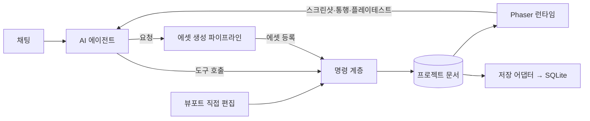

# AI 네이티브 게임 에디터 — 설계

- 날짜: 2026-11-13
- 상태: 설계 승인됨. 0단계 결과 반영 (`2026-11-13-stage0-spike-result.md`)
- 작업 이름: `ai-game-editor` (제품 이름은 미정이며 이 문서의 범위가 아니다)

## 1. 목표

코드를 모르는 창작자가 채팅만으로 Eastward 톤의 탑다운 픽셀아트 액션 어드벤처 장면을 만들고, 원하면 손으로 세부를 고칠 수 있는 웹 에디터를 만든다.

### v1 성공 기준

처음 온 사람이 설명 없이 한두 문장을 입력하면, 몇 분 안에 다음이 모두 되는 장면 하나가 생긴다.

- 새로 생성된 에셋(지형, 소품, 건물, 캐릭터)으로 그려진 장소 하나
- 동적 조명과 후처리가 적용된 분위기
- 주인공으로 걸어 다니기
- NPC와 대화하기
- 적 한두 종과 싸우기

### 결정 사항

| 항목 | 결정 |
|---|---|
| 기존 프로젝트와의 관계 | 완전히 새 프로젝트. 코드·에셋을 가져오지 않는다 |
| 1차 사용자 | 코드를 모르는 창작자 (공개 제품) |
| 재현할 Eastward 요소 | 비주얼, 탑다운 액션 어드벤처, 서사 중심 |
| 에셋 출처 | AI 가 생성한다 |
| 플랫폼 | 웹 먼저, 데스크톱은 나중 |
| 게임 런타임 | Phaser |
| 정본 방식 | 데이터 정본 + 좁은 스크립트 탈출구 |
| DB | SQLite (서버 쪽) |
| 프런트엔드 감성 | 애플 프로 앱처럼 고급스럽게 |
| 진행 순서 | 에셋 생성 스파이크를 먼저 한다 |

### v1 에서 하지 않는 것

여러 맵과 맵 연결, 진행 상태·퀘스트, 컷신 타임라인, 스크립트 작성 기능, 픽셀 단위 스프라이트 편집기, 계정·로그인, 공유 링크, 데스크톱 앱, 2인 캐릭터 전환, 히스토리 분기.

## 2. 제품 형태와 UX

### 화면 구성

화면은 채팅과 뷰포트 둘뿐이다. 패널, 탭, 씬 트리, 메뉴 바는 기본 화면에 없다.

```
┌───────────────┬──────────────────────────────────┐
│ 채팅           │ 뷰포트 = 실제 게임        [▶ 플레이] │
│               │                                  │
│ ┌ 변경 카드 ┐  │      (클릭한 대상 옆에만)           │
│ │전/후·되돌리기│ │      ┌ 인스펙터 ┐                │
│ └──────────┘  │      └─────────┘                │
│ [입력창 + 칩]  │                    히스토리 ─●──● │
└───────────────┴──────────────────────────────────┘
```

### 상호작용 원칙

1. **뷰포트가 곧 게임이다.** 별도 미리보기가 없다. ▶ 를 누르면 그 자리에서 플레이되고, 멈추면 편집으로 돌아온다.
2. **가리키며 말한다.** 뷰포트에서 대상을 클릭하거나 영역을 드래그하면 채팅 입력창에 칩으로 붙는다. 칩은 엔티티 id 또는 타일 좌표 영역을 담아 에이전트에 전달된다.
3. **변경 카드.** AI 의 한 턴이 바꾼 것을 전/후 썸네일과 한 줄 요약으로 보여 주고, 카드마다 되돌리기 버튼이 있다.
4. **세부 편집은 점진적으로 공개한다.**
   - 클릭: 속성 몇 개만 있는 작은 인스펙터가 대상 옆에 뜬다.
   - 더블클릭: 그 대상 전용 편집 모드로 들어간다.
   - 손으로 한 편집도 AI 편집과 같은 히스토리에 쌓인다.
5. **Cmd+K 커맨드 팔레트**로 모든 기능을 검색한다.
6. **히스토리 타임라인**으로 어느 시점으로든 돌아간다. v1 은 선형이다.
7. **코드는 어디에도 노출하지 않는다.**

### v1 세부 편집 범위

- 배치: 이동, 복제, 삭제
- 속성 인스펙터: 이름, 체력, 행동 프리셋, 충돌 여부 등 엔티티 종류별 속성
- 타일 붓: 지형 재질을 칠하면 가장자리가 자동으로 이어진다
- 대화 텍스트 편집
- 조명: 광원 위치·색·세기·반경, 장면 주변광

스프라이트 그림 자체를 바꾸고 싶을 때는 "다시 그려줘"와 팔레트 교체로 대응한다.

### 시각 언어

애플 프로 앱(Final Cut, Logic) 방향이다.

- 반투명 재질과 은은한 깊이감, 넉넉한 여백
- 시스템 서체 스택, 한글은 Pretendard
- 스프링 기반 애니메이션
- 시스템 라이트/다크 설정을 따른다
- 뷰포트가 주인공이다. 크롬은 뷰포트 위에 떠 있고, 쓰지 않을 때 물러난다

dev tool 느낌은 외형이 아니라 동작에서 낸다: 키보드 우선, Cmd+K, 변경 카드, 히스토리.

### 첫 사용 경험

빈 프로젝트는 입력창 하나와 예시 요청 몇 개만 보여 준다. 튜토리얼이나 설정 화면은 없다.

## 3. 아키텍처



### 저장소 구조

TypeScript 모노레포. 패키지마다 책임이 하나다.

| 패키지 | 책임 | 의존 |
|---|---|---|
| `model` | 프로젝트 문서 스키마, 명령과 역명령, 린트. 순수 함수이고 브라우저·서버 양쪽에서 돈다 | 없음 |
| `runtime` | 프로젝트 문서를 Phaser 로 그리고 플레이한다 | `model` |
| `editor` | 웹 에디터 셸 (React). 채팅, 뷰포트 오버레이, 인스펙터, 팔레트, 히스토리 | `model`, `runtime` |
| `agent` | 에이전트 루프, 도구 정의, 시스템 프롬프트 | `model` |
| `assets` | 에셋 생성, 후처리, 검사 | `model` |
| `server` | HTTP API, SQLite 저장, AI·생성 호출 중계, 에셋 파일 제공 | `model`, `agent`, `assets` |

### 프로젝트 문서

스키마가 정해진 JSON 하나가 유일한 정본이다.

```
Project
├─ meta        이름, 스키마 버전
├─ style       스타일 문서 (4절)
├─ assets      id → { 종류, 파일 참조, 크기, 프레임, 충돌 발자국, 가림 경계선 }
├─ prefabs     id → { 에셋 참조, 종류(주인공·NPC·적·소품·건물), 기본 속성 }
└─ scenes      id → Scene
     ├─ size, tileSize
     ├─ terrain     재질 id 격자 (오토타일은 런타임과 model 이 격자에서 유도)
     ├─ entities    { id, prefab, 위치, 속성 덮어쓰기, behaviorScript? }
     ├─ lights      주변광 + 점광원 목록 { 위치, 색, 세기, 반경 }
     ├─ post        후처리 설정 (색 보정, 블룸, 비네트)
     ├─ dialogues   id → 대사 노드 목록 (화자, 글, 선택지)
     └─ events      { 트리거(접촉·상호작용·시작), 동작 목록(대화, 이동, 카메라, 플래그) }
```

- 통행 격자는 저장하지 않는다. 지형 재질의 통행 속성과 엔티티의 충돌 발자국에서 유도한다.
- v1 은 프로젝트당 장면이 하나지만 스키마는 `scenes` 를 맵으로 둔다.
- `behaviorScript` 는 v1 에서 스키마에만 있고 항상 비어 있다 (아래 "스크립트 탈출구").

### 명령 계층

문서를 바꾸는 유일한 통로다. AI 도구 호출과 손 편집이 같은 명령을 낸다.

- 명령은 `{ type, params }` 이고, 적용은 `(문서, 명령) → (새 문서, 역명령)` 순수 함수다.
- 적용 전에 스키마와 불변 조건을 검사한다. 실패하면 문서는 그대로이고 사유를 돌려준다.
- 트랜잭션: 명령 여러 개를 하나로 묶는다. AI 의 한 턴 = 한 트랜잭션 = 변경 카드 하나 = 되돌리기 단위 하나. 손 편집은 조작 하나(드래그 한 번, 붓질 한 번)가 한 트랜잭션이다.
- 히스토리는 트랜잭션의 선형 목록이다. 과거 시점으로 돌아간 뒤 새로 편집하면 그 뒤의 기록은 버린다.

v1 명령:

| 영역 | 명령 |
|---|---|
| 지형 | `paintTerrain`, `fillTerrain`, `resizeScene` |
| 엔티티 | `addEntity`, `moveEntity`, `removeEntity`, `setEntityProps` |
| 프리팹·에셋 | `registerAsset`, `replaceAsset`, `definePrefab`, `updatePrefab` |
| 조명 | `addLight`, `updateLight`, `removeLight`, `setAmbient`, `setPost` |
| 서사 | `setDialogue`, `removeDialogue`, `addEvent`, `updateEvent`, `removeEvent` |
| 스타일 | `setStyle` |

### 린트

문서 전체를 읽어 문제를 좌표와 함께 보고한다. 명령을 막지는 않고, 에이전트와 사용자에게 보여 준다.

- 주인공 시작 위치에서 닿을 수 없는 NPC·출입구·상호작용 대상
- 없는 에셋이나 프리팹을 가리키는 참조
- 주인공이 없거나 둘 이상
- 대화나 이벤트가 없는 대상을 가리킴
- 통행 불가 칸 위에 놓인 캐릭터

### 런타임

문서를 해석만 한다. 자체 상태를 정본으로 갖지 않는다.

- **편집 모드:** 문서를 그대로 그린다. 문서가 바뀌면 바뀐 부분만 다시 그린다. 시뮬레이션은 멈춰 있다.
- **플레이 모드:** 문서의 사본으로 시뮬레이션을 돌린다. 멈추면 사본을 버린다.
- **헤드리스 모드:** 화면 없이 같은 시뮬레이션을 돌린다. 에이전트의 플레이테스트는 브라우저에서, 자동 테스트는 Node 에서 이 모드를 쓴다.

시스템은 다섯 개다.

| 시스템 | v1 범위 |
|---|---|
| 이동·충돌 | 8방향 이동, 격자 통행 + 엔티티 발자국 충돌, 키 큰 대상 뒤로 지나가기(가림 경계선 기준 깊이 정렬) |
| 전투 | 근접 공격 판정, 체력, 피격 넉백·무적 시간, 적 행동 프리셋 3종(추적, 순찰, 원거리) |
| 대화 | 대사 상자, 화자 이름, 선택지 |
| 이벤트 | 트리거 3종(접촉, 상호작용, 장면 시작) → 동작 목록 순차 실행 |
| 조명·후처리 | 주변광, 점광원, 색 보정, 블룸, 비네트 |

Phaser 4.2.1 을 쓴다. 조명은 주변광을 칠한 렌더 텍스처에 점광원을 더해 장면 위에 곱하기로 얹고, 카메라 필터로 색 보정·블룸·비네트를 건다 (0단계에서 확정).

### 에이전트

- 서버에서 돈다. 모델은 Claude 이고 API 키는 서버만 갖는다.
- **변경 도구**는 명령 계층의 명령과 일대일이다.
- **관찰 도구:** 문서 요약 읽기, 뷰포트 영역 스크린샷, 통행 검사, 린트 실행, 헤드리스 플레이테스트(주인공을 목표 지점까지 걷게 하기, 전투 한 번 돌리기).
- **생성 도구:** 에셋 생성 요청 (4절).
- **턴의 흐름:** 요청 이해 → 계획 → 트랜잭션 안에서 명령 적용 → 스크린샷과 린트로 결과 확인 → 필요하면 수정 → 트랜잭션 확정, 변경 카드 작성.
- 스크린샷과 플레이테스트는 브라우저의 런타임이 수행하고 결과를 서버의 에이전트로 보낸다. 서버는 문서의 권위 있는 사본을 갖고, 브라우저는 확정 전 트랜잭션을 실시간으로 받아 그린다.
- 사용자가 가리킨 칩(엔티티 id, 좌표 영역)은 요청과 함께 전달된다.

### 스크립트 탈출구

v1 은 자리만 둔다.

- 엔티티의 `behaviorScript` 슬롯, 스크립트가 쓸 수 있는 좁은 API 의 타입 정의(자기 위치·상태 읽기, 이동·공격 요청, 타이머, 이벤트 발행), 샌드박스 실행 인터페이스를 `model` 과 `runtime` 에 정의한다.
- 스크립트 작성·실행 기능은 구현하지 않는다. 적 행동은 프리셋으로만 고른다.

### 저장

- 서버의 SQLite 파일 하나에 프로젝트, 트랜잭션 히스토리, 에셋 메타데이터, 채팅 기록을 둔다.
- 에셋 이미지는 서버 디스크에 내용 해시 이름으로 둔다.
- `server` 는 저장 어댑터 인터페이스 뒤에서 SQLite 를 쓴다. 데스크톱 버전은 같은 스키마의 SQLite 를 로컬에서 쓰도록 어댑터만 바꾼다.
- 계정이 없다. 프로젝트는 추측 불가능한 id 가 든 주소로 연다. 이 주소는 편집 권한을 겸한다.
- 트랜잭션이 확정될 때마다 저장한다. 저장 버튼은 없다.

## 4. 에셋 생성

### 원칙

1. **분위기와 내용을 나눈다.** 조명과 후처리는 런타임이 결정적으로 처리한다. 생성이 책임지는 것은 무엇이 그려져 있는가뿐이다.
2. **스타일 문서로 일관성을 잠근다.** 프로젝트의 `style` 에 팔레트, 타일당 화소 수(24), 시점(3/4 탑다운 정면 고정), 빛 방향, 외곽선 규칙을 둔다. 모든 생성 요청이 이 문서를 조건으로 받는다.
3. **모든 생성물은 같은 후처리와 검사를 통과해야 등록된다.** 화소 격자 맞춤, 팔레트 양자화, 투명 정리를 거친 뒤 크기·팔레트·투명 영역을 검사한다.
4. **Eastward 원본 그림을 생성 입력으로 쓰지 않는다.** 스타일은 글과 수치로 적은 규칙으로 전달한다.

### 종류별 범위

| 종류 | 생성하는 것 | 코드가 결정적으로 만드는 것 |
|---|---|---|
| 지형 | 재질 무늬 | 가장자리 이음(오토타일) |
| 소품·건물 | 스프라이트 | 충돌 발자국, 가림 경계선 |
| 캐릭터 | 디자인 | 고정 포즈 틀에 맞춘 프레임 배치(대기, 4방향 걷기, 공격) |
| 조명 | 광원 위치·색 제안 | 실제 빛 계산, 후처리 |

### 0단계 스파이크

**질문:** 한두 문장 요청으로 한 장면 분량(지형 재질 3, 소품 8, 건물 2, 주인공·NPC·적 2종)을 일관된 Eastward 톤으로 뽑을 수 있는가.

**해 볼 것:** 같은 요청으로 세 방식을 비교한다.

- (가) 이미지 모델 + 후처리
- (나) 모델이 코드로 화소를 찍는 방식
- (다) 둘의 혼합

결과를 Phaser 정지 장면에 조명과 함께 얹는다. 건물은 통그림 한 장과 부품 조립 두 가지를 모두 해 본다.

**통과 기준:**

- 팔레트·화소 밀도·시점이 에셋 간에 일치한다
- 타일 이음새가 보이지 않는다
- 걷기 애니메이션이 프레임 간 깜빡임 없이 읽힌다
- 같은 요청 3회 중 2회 이상 쓸 만하다
- 장면 하나 분량이 5분 안에 나온다
- 장면 하나당 비용을 측정해 비교 페이지에 적는다 (감당할 수준인지는 사용자가 판정한다)

**판정:** 방식별 결과를 나란히 놓은 비교 페이지를 사용자가 직접 보고 정한다.

**결과에 따른 분기:**

- 전부 통과: 고른 방식으로 5단계를 진행한다.
- 일부 종류만 실패: 그 종류만 내장 키트로 대체한다.
- 전부 실패: 에셋 출처 결정을 다시 연다.

**산출물:** 결론, 스타일 문서 초안, Phaser 버전과 조명 구현 방식의 확정, 2~4단계에서 임시로 쓸 에셋 한 벌. 스파이크 코드는 버린다.

## 5. 오류 처리

| 상황 | 동작 |
|---|---|
| 명령이 검사에 실패 | 문서는 그대로. 사유를 호출자(에이전트 또는 UI)에 돌려준다 |
| AI 턴이 중간에 실패하거나 사용자가 중단 | 트랜잭션 전체를 되돌린다. 문서는 턴 시작 전 상태다 |
| 에셋 생성물이 검사에 실패 | 두 번까지 다시 시도한다. 그래도 실패하면 임시 그림을 넣고 무엇이 실패했는지 채팅에 그대로 알린다 |
| 턴이 끝났는데 린트 문제가 남음 | 변경 카드에 남은 문제를 표시한다 |
| 플레이 중 런타임 오류 | 플레이를 멈추고 편집 모드로 돌아온다. 문서는 영향받지 않는다 |
| 저장 실패 | 자동으로 다시 시도하고, 계속 실패하면 저장되지 않았음을 화면에 표시한다 |
| 구버전 스키마의 프로젝트 | 열 때 버전 순서대로 마이그레이션한다 |

## 6. 테스트

- **`model`:** 모든 명령에 대해 "적용 후 역명령 = 원본" 왕복 테스트. 검사 실패 사례. 린트 규칙별 사례.
- **`runtime`:** 헤드리스 모드로 이동·충돌·전투·대화·이벤트를 고정 문서에 대해 검증. 조명은 스크린샷 비교.
- **`agent`:** 고정 요청 세트를 돌려 결과 문서의 린트 통과 여부, 요청 충족 여부(스크린샷 판정), 턴 수·비용을 기록하는 평가.
- **`assets`:** 후처리와 검사의 단위 테스트. 생성 품질은 평가 세트의 통과율로 추적한다.
- **`editor`:** 브라우저 자동화로 핵심 흐름(요청 → 장면 → 손 편집 → 되돌리기 → 플레이) 검증.

## 7. 로드맵

각 단계는 확인 가능한 결과물로 끝난다. 구현 계획은 단계마다 따로 쓴다.

| 단계 | 만드는 것 | 완료 기준 |
|---|---|---|
| 0. 에셋 스파이크 | 생성 방식 비교, 스타일 문서 초안 | 사용자가 비교 페이지를 보고 방식을 정함 |
| 1. 뼈대 | 모노레포, 프로젝트 문서 스키마, 명령 계층·히스토리, SQLite 저장 | 명령으로 장면을 만들고, 되돌리고, 저장 후 다시 불러오는 테스트 통과 |
| 2. 런타임 | Phaser 로 문서 그리기, 다섯 시스템 | 손으로 쓴 문서 하나가 "한 장면"으로 플레이됨 |
| 3. 에디터 셸 | 채팅+뷰포트 화면, 선택·배치, 인스펙터, 타일 붓, 대화·조명 편집, Cmd+K, 히스토리, 플레이 전환 | AI 없이 손만으로 장면을 고칠 수 있음 |
| 4. 에이전트 | 변경·관찰 도구, 검증 루프, 변경 카드, 가리키며 말하기 | 기존 에셋으로 한 문장 → 플레이 가능한 장면 |
| 5. 에셋 생성 통합 | 고른 방식을 파이프라인으로, 후처리·검사·등록 | 한 문장 → 새로 생성된 에셋으로 된 장면 (v1 성공 기준) |
| 6. 다듬기 | 첫 사용 경험, 시각 마감, 에이전트 평가 세트 | 처음 온 사람이 설명 없이 장면을 만들어 냄 |

- 0단계가 맨 앞인 것은 결과에 따라 5단계와 에셋 출처 결정이 바뀌기 때문이다.
- 런타임이 에디터와 에이전트보다 앞인 것은 뷰포트가 곧 런타임이고 에이전트의 검증이 런타임에 의존하기 때문이다.
- 3단계와 4단계는 1·2단계가 끝나면 나란히 진행할 수 있다.
- 2~4단계는 스파이크에서 나온 에셋을 임시 그림으로 쓴다.
